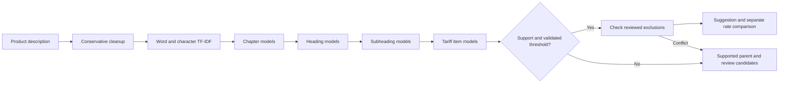
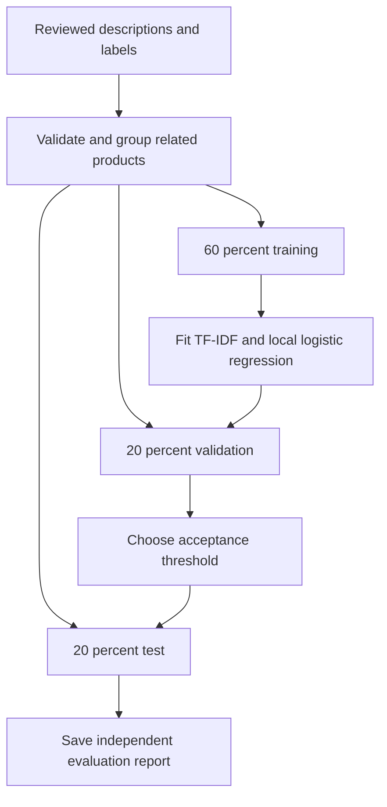

# customsAI

CPU-only hierarchical tariff classification and Bill of Entry review.

Word and character TF-IDF feed a logistic regression model at each parent in the tariff tree. Prediction keeps three competing paths through chapter (2 digits), heading (4), subheading (6), and tariff item (8). Only real master codes can be suggested. The declared code is compared after prediction and never enters the classifier.



No LLM, neural network, GPU, embedding download, BM25, alias index, chat, or precedent service. Authentication, job persistence, Excel upload/download, and reviewer corrections remain.

## Local setup

Run from the repository root with Python 3.11 or newer:

```powershell
python -m venv .venv
.venv/Scripts/python.exe -m pip install -r backend/requirements.txt
Copy-Item backend/.env.example backend/.env
```

Optional offline data builder dependencies are separate from the API runtime:

```powershell
.venv/Scripts/python.exe -m pip install -r backend/requirements-data.txt
.venv/Scripts/python.exe -m backend.app.scripts.build_enriched_dataset --skip-existing
```

The builder reads the supplied CUSTADA workbooks, tariff PDFs and notifications. It produces `data/enriched/cth_master.parquet`. These schedule descriptions define the label tree; they are not verified invoice training examples.

## Training

Provide a reviewed CSV with these columns:

| Column | Meaning |
|---|---|
| description | Product description, including the specifications needed to distinguish its code |
| cth | Verified eight-digit string, including leading zeros |
| verified | `true` for an expert-reviewed label; unverified rows are rejected |
| group_id | Optional product family identifier; related products must share a group |

Do not use an importer-declared code as a verified label without reviewing it. Add material, composition, voltage, intended function or other relevant details when the description is ambiguous. Identical cleaned descriptions with conflicting labels are rejected.

```powershell
.venv/Scripts/python.exe -m backend.scripts.train reviewed.csv --tariff-version "2025-26"
```

At least ten independent groups are required for a meaningful three-way split. This minimum only makes the workflow runnable; adequate label coverage needs substantially more representative examples. Duplicate descriptions and linked product families never cross splits. Repeated identical examples do not inflate support counts. The vocabulary and models are fitted on the 60% training partition. The 20% validation partition chooses a score threshold; the untouched 20% test partition measures performance.



Outputs:

- `data/enriched/models/hierarchy.joblib`: compressed local model, loaded once per process.
- `data/enriched/models/hierarchy.report.json`: 2/4/6/8 digit accuracy and macro F1, top-three accuracy, automatic coverage, accepted accuracy, unseen test codes, and a flat logistic-regression baseline.

The score is an **uncalibrated model score**, not a probability of correctness. The default threshold requires at least twenty validation predictions meeting 95% empirical accuracy. If that evidence is absent, automatic classification stays disabled. This is not a statistical coverage guarantee. All siblings on a predicted path must have training examples; a leaf needs at least three distinct training descriptions. Insufficient support returns a parent prefix and review candidates. Restart the backend after retraining. Changing the master or preprocessing requires retraining.

**There are no expert-verified training examples in this checkout.** Until you supply them and train a model, uploads produce explicit review results; no declared-code or nearest-text fallback pretends to be a trained classifier. Tests use synthetic examples solely to verify implementation behavior.

## Run

```powershell
.venv/Scripts/python.exe -m uvicorn backend.app.main:app --reload
```

In another terminal:

```powershell
cd frontend
npm ci
npm run dev
```

Upload an `.xlsx` file with Description, CTH, and optional BCD / assessable value columns. Results show model suggestions, scores, review reasons and alternative paths. The table requests fifty rows per page. Excel exports include all rows.

`/api/health` separates API readiness from `classification_available`. A missing model allows review workflows; an incompatible model fails readiness. No external AI keys are used.

## Corrections and retraining

Reviewer corrections are saved to the existing database. Export the local unsigned-in corrections, or select one authenticated user:

```powershell
.venv/Scripts/python.exe -m backend.scripts.export_feedback review.csv --local
# Or: --user-id 123
```

The export deliberately sets `verified=false`. Review the labels, assign related product groups, and mark approved records `true` before running the training command. Retraining is an explicit offline operation and never runs inside a request.

## Tariff rules and rates

This classifier suggests categories; it does not establish legal interpretation. Optional expert-reviewed exclusions can be supplied as `data/enriched/rules.json`:

```json
[
  {
    "id": "your-reviewed-rule",
    "citation": "Exact source and scope verified by your reviewer",
    "all_tokens": ["product", "attribute"],
    "excluded_prefixes": ["99"]
  }
]
```

That example is a schema illustration, not an actual tariff rule. Tokens must match the cleaned description. Rule conflicts always send the row to review. There is no bundled legal rule pack or claim of complete GIR coverage.

Conditional rates and notification claims require separate review. The application compares only an unconditional numeric master rate; it does not infer exemptions from keyword overlap, passive-component labels, or an importer claim. Uncertain classifications create no underpayment finding.

## Checks

```powershell
.venv/Scripts/python.exe -m pip install -r backend/requirements-dev.txt
.venv/Scripts/python.exe -m pytest backend/tests -q
cd frontend
npm run typecheck
npm run build
```

See [DEPLOY.md](DEPLOY.md) for deployment. Raw source documents remain available for reproducible tariff builds. Generated datasets, model files, uploads and databases are ignored by Git.
