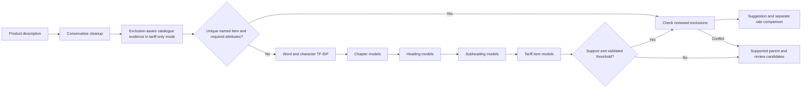
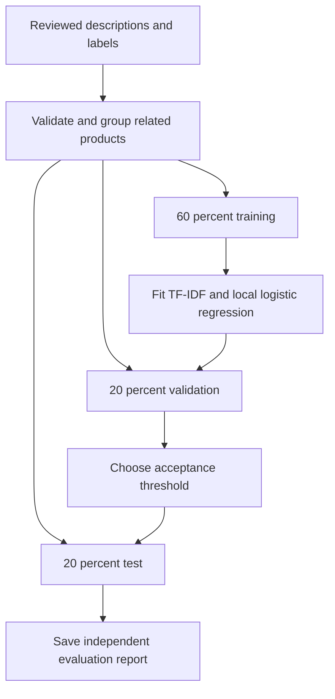

# customsAI

CPU-only hierarchical tariff classification and Bill of Entry review.

Word and character TF-IDF feed a logistic regression model at each parent in the tariff tree. Prediction makes conditional decisions in top-down hierarchy order and keeps three alternatives through chapter (2 digits), heading (4), subheading (6), and tariff item (8). Products of probabilities are not used to switch into an unrelated, smaller subtree. Only real master codes can be suggested. The declared code is compared after prediction and never enters the classifier.



No LLM, neural network, GPU, embedding download, BM25, alias index, chat, or precedent service. Authentication, job persistence, Excel upload/download, and reviewer corrections remain.

## Local setup

Run from the repository root with Python 3.11 or newer:

```powershell
python -m venv .venv
.venv/Scripts/python.exe -m pip install -r backend/requirements.txt
Copy-Item backend/.env.example backend/.env
```

Optional offline data builder dependencies are separate from the API runtime:

```powershell
.venv/Scripts/python.exe -m pip install -r backend/requirements-data.txt
.venv/Scripts/python.exe -m backend.app.scripts.build_enriched_dataset --skip-existing
```

The builder reads the supplied CUSTADA workbooks, tariff PDFs and notifications. It produces `data/enriched/cth_master.parquet`. These schedule descriptions define the label tree; they are not verified invoice training examples.

## Training

To start without a verified invoice dataset, train an explicitly marked tariff-only baseline:

```powershell
.venv/Scripts/python.exe -m backend.scripts.train --tariff-only --tariff-version "2025-26"
```

This fits the same hierarchy using distinct leaf and hierarchy-context views from the supplied catalogue. Views of one tariff row count as one independent source. It never uses the uploaded sample's declared codes as labels. The report explicitly leaves invoice accuracy unmeasured and statistical-score acceptance disabled. A separate high-precision catalogue check can accept a unique explicit positive tariff-name match, provided inherited specifications are satisfied. It rejects exclusions, accessory mentions, colliding names and incomplete conditions. The app displays the basis for each acceptance; this is not a calibrated probability or an exemption decision.

For supervised training and independent evaluation, provide a reviewed CSV with these columns:

| Column | Meaning |
|---|---|
| description | Product description, including the specifications needed to distinguish its code |
| cth | Verified eight-digit string, including leading zeros |
| verified | `true` for an expert-reviewed label; unverified rows are rejected |
| group_id | Optional product family identifier; related products must share a group |

Do not use an importer-declared code as a verified label without reviewing it. Add material, composition, voltage, intended function or other relevant details when the description is ambiguous. Identical cleaned descriptions with conflicting labels are rejected.

```powershell
.venv/Scripts/python.exe -m backend.scripts.train reviewed.csv --tariff-version "2025-26"
```

At least ten independent groups are required for a meaningful three-way split. This minimum only makes the workflow runnable; adequate label coverage needs substantially more representative examples. Duplicate descriptions and linked product families never cross splits. Repeated identical examples do not inflate support counts. The vocabulary and models are fitted on the 60% training partition. The 20% validation partition chooses a score threshold; the untouched 20% test partition measures performance.



Outputs:

- `data/enriched/models/hierarchy.joblib`: compressed local model, loaded once per process.
- `data/enriched/models/hierarchy.report.json`: 2/4/6/8 digit accuracy and macro F1, top-three accuracy, automatic coverage, accepted accuracy, unseen test codes, and a flat logistic-regression baseline.

The score is an **uncalibrated model score**, not a probability of correctness. The default threshold requires at least twenty validation predictions meeting 95% empirical accuracy. If that evidence is absent, statistical-score acceptance stays disabled; the separate explicit-name catalogue gate can still accept a fully specified unique match. This is not a statistical coverage guarantee. All siblings on a predicted path must have training examples; a leaf needs at least three distinct training descriptions. Insufficient support returns a parent prefix and review candidates. The backend detects an atomically replaced model automatically. Changing the master or preprocessing requires retraining.

**There are no expert-verified invoice training examples in this checkout.** Use tariff-only mode for labelled suggestions, or supply reviewed invoice examples to establish independent accuracy and automatic acceptance. Tests use synthetic examples solely to verify implementation behavior.

## Run

```powershell
.venv/Scripts/python.exe -m uvicorn backend.app.main:app --reload
```

Development uses `.next-dev`; production builds use `.next`, so building while the app runs does not overwrite its active bundles.

In another terminal:

```powershell
cd frontend
npm ci
npm run dev
```

Upload an `.xlsx` file with Description, CTH, and optional BCD / assessable value columns. Results show model suggestions, scores, review reasons and alternative paths. The Reclassify button creates a new run with the current model, preserving the earlier audit. Suggested codes and accepted codes are separate fields in the Excel export. The table requests fifty rows per page. Excel exports include all rows.

`/api/health` separates API readiness from `classification_available`. A missing model allows review workflows; an incompatible model fails readiness. No external AI keys are used.

## BCD match scoring and review priority

The results table compares the provided BCD with a **verified applicable reference**, independently of the classification model score. Equal verified rates (including 0% vs 0%) score 100/100. Otherwise the agreement score is `100 * (1 - abs(provided - reference) / max(provided, reference))`, bounded to 0..100. Differences of at most 0.01 percentage points count as a match. Thus 5% vs 10% scores 50/100 in either direction; only the lower provided rate indicates potential underpayment.

When classification or notification verification is pending, the table shows the leading eight-digit model candidate and its statutory catalogue BCD as an **estimate**. The same formula produces an estimated rate-agreement score, not a probability that the CTH or applicable duty is correct. Notification concessions are not assumed. No candidate, missing catalogue rate, missing provided rate or legal conflict leaves the comparison unavailable; declared values are never copied as predictions. Estimates stay red and require review, even at 100/100. Any uncertain result, rate discrepancy, CTH mismatch or other review flag makes the entire table and exported Excel row red. Red is a review signal and does not establish fraud.

The Excel export includes **Estimated CTH**, **Estimated statutory BCD %**, **BCD match score /100**, **BCD comparison status**, **Fraud review priority**, **Potential BCD underpayment**, **BCD difference (percentage points)**, **BCD comparison reason**, and **Needs review**. High priority means a provided rate below a verified reference; Medium means a CTH mismatch despite equal BCD; Low means no BCD underpayment is indicated; Review required means evidence is incomplete. Neither the score nor priority is a calibrated probability of fraud. Historical results are assessed on read, and downloads are regenerated with the current scoring columns without changing saved classification decisions.

## Corrections and retraining

Reviewer corrections are saved to the existing database. Export the local unsigned-in corrections, or select one authenticated user:

```powershell
.venv/Scripts/python.exe -m backend.scripts.export_feedback review.csv --local
# Or: --user-id 123
```

The export deliberately sets `verified=false`. Review the labels, assign related product groups, and mark approved records `true` before running the training command. Retraining is an explicit offline operation and never runs inside a request.

## Catalogue evidence and partial classification

Tariff-only mode no longer accepts nothing by construction. Unique positive leaf names can produce an accepted eight-digit code, while model guesses remain gated by validation. A named diode is not matched to a tariff entry that says it excludes that diode. A connector mentioned in packaging or machinery exclusions is not treated as the primary article. Parent specifications such as rated voltage still have to be supplied and checked.

When the description supports only a chapter or heading, the app displays that prefix and labels the result **Needs specifications**, instead of displaying a wrong eight-digit guess. The bare term `terminal`, for example, may need its function and electrical characteristics before classification is possible.

`backend/app/ml/catalogue_aliases.json` contains source-linked terminology for broader heading support. The connection/contact element terminology is grounded in the [CBIC notification](https://new.cbic.gov.in/resources/htdocs-cbec/11-2018_cus_exempts_goods_from_sws.pdf); this supports a heading, not automatic eight-digit classification or concession eligibility.

The local `data/enriched/models/accuracy_improvement.report.json` records a nine-case regression comparison at explicitly stated hierarchy levels. It is not a blinded independent invoice benchmark and must not be presented as overall eight-digit accuracy.

## Tariff rules and rates

This classifier suggests categories; it does not establish legal interpretation. Optional expert-reviewed exclusions can be supplied as `data/enriched/rules.json`:

```json
[
  {
    "id": "your-reviewed-rule",
    "citation": "Exact source and scope verified by your reviewer",
    "all_tokens": ["product", "attribute"],
    "excluded_prefixes": ["99"]
  }
]
```

That example is a schema illustration, not an actual tariff rule. Tokens must match the cleaned description. Rule conflicts always send the row to review. There is no bundled legal rule pack or claim of complete GIR coverage.

Conditional rates and notification claims require separate review. The application compares only an unconditional numeric master rate; it does not infer exemptions from keyword overlap, passive-component labels, or an importer claim. Uncertain classifications create no underpayment finding.

## Checks

```powershell
.venv/Scripts/python.exe -m pip install -r backend/requirements-dev.txt
.venv/Scripts/python.exe -m pytest backend/tests -q
cd frontend
npm run typecheck
npm run build
```

See [DEPLOY.md](DEPLOY.md) for deployment. Raw source documents remain available for reproducible tariff builds. Generated datasets, model files, uploads and databases are ignored by Git.
